<p align="center">
  
</p>

<p align="center">
  <a href="__LIVE__"><b>🌿 Live demo</b></a> ·
  <a href="#-features">Features</a> ·
  <a href="#-screenshots">Screenshots</a> ·
  <a href="#-how-it-works">How it works</a> ·
  <a href="#-tech-stack">Tech stack</a> ·
  <a href="#setup">Run it locally</a>
</p>

<p align="center">
  
  
  
  
  
  
</p>

---

**Elevo** is a full-stack academic mentoring platform built for the Department of Information Science & Engineering, NMAM Institute of Technology. It gives a department one calm place to keep semester records, spot students who need help early, and keep the conversation between mentor and mentee going all year.

<table>
<tr>
<td width="33%" valign="top">

### 🎓 Students
Enter marks, watch SGPA/CGPA grow, check in weekly with **Pulse**, plan grade targets and ask their mentor privately. They only ever compare with their own past.

</td>
<td width="33%" valign="top">

### 🧑‍🏫 Mentors
See only their assigned mentees. They get a roster with plain-language risk flags, verify semesters, answer questions, log sessions, share resources and download PDF reports.

</td>
<td width="33%" valign="top">

### 🏛️ HOD
Assign mentors by drag and drop with undo, review interventions and analytics, import results, export summaries, manage users and grading, and read the audit history.

</td>
</tr>
</table>

## ✨ Features

- **Semester records:** configurable grading, mentor verification, and corrections that need approval and are audited.
- **Transparent insights:** rule-based risk indicators with a "Why am I seeing this?" panel that shows the evidence. If the inputs are missing, the page says "Not enough data" and explains why.
- **Weekly Pulse:** a 30-second check-in on mood and workload that the mentor can follow week to week.
- **Ask My Mentor:** private question threads with statuses and notifications.
- **Grade Goal Planner:** what-if SGPA/CGPA targets that a student can save and share.
- **Stepping-Stones journey:** a timeline of each student's milestones.
- **Assignment Board:** drag and drop, fully keyboard accessible, with Undo.
- **PDF reports, imports and exports:** reports are built from verified records only, with CSV/XLSX/PDF exports and bulk imports from templates.
- **Accessible by default:** 44 px touch targets, text contrast of at least 4.5:1, a table alternative for every chart, and axe checks at 390/834/1440 px.

## 📸 Screenshots

| Student dashboard | Academic record |
|---|---|
| 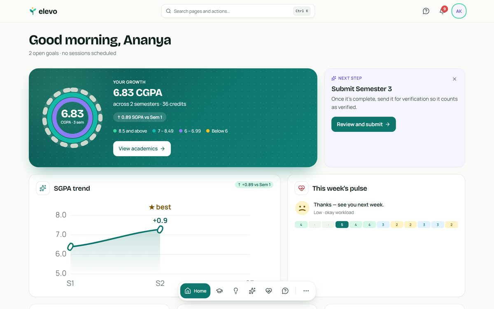 | 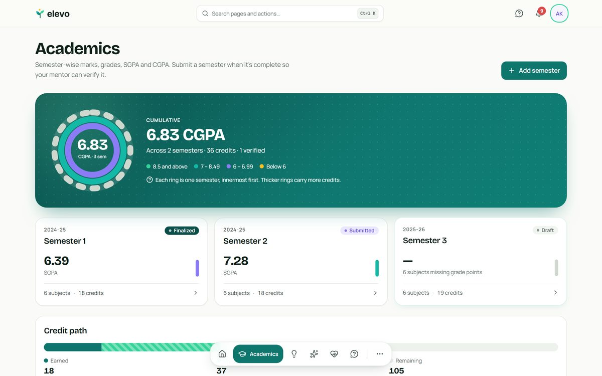 |
| **Insights with evidence** | **Weekly Pulse** |
| 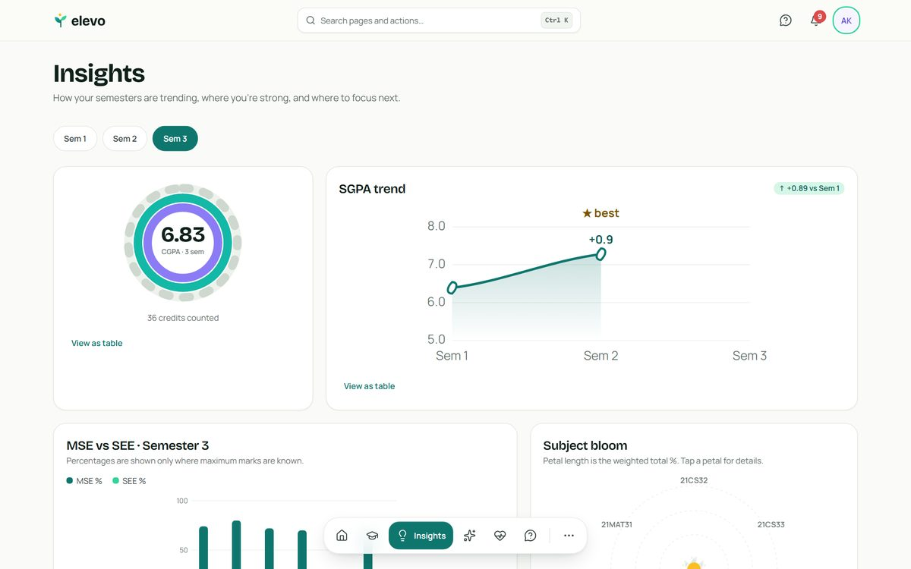 | 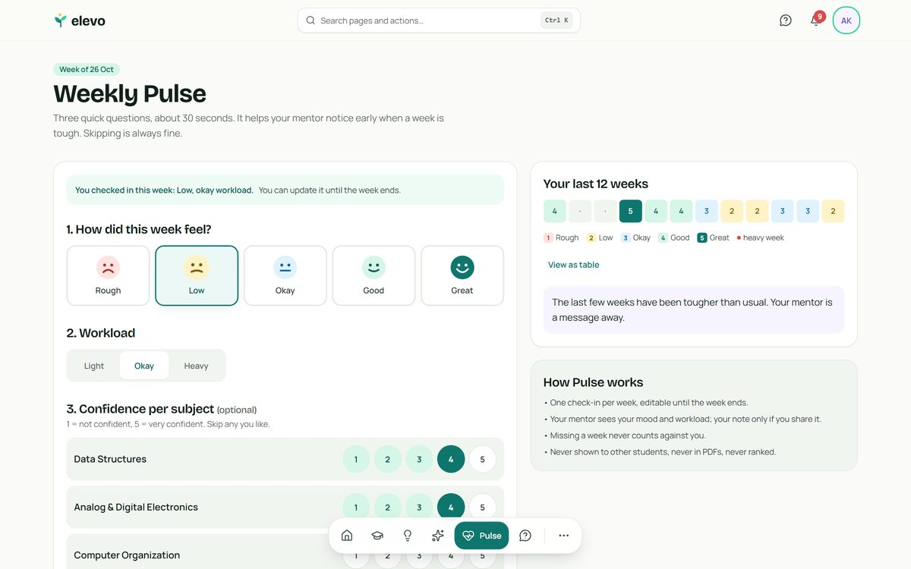 |
| **Grade Goal Planner** | **Stepping-Stones journey** |
| 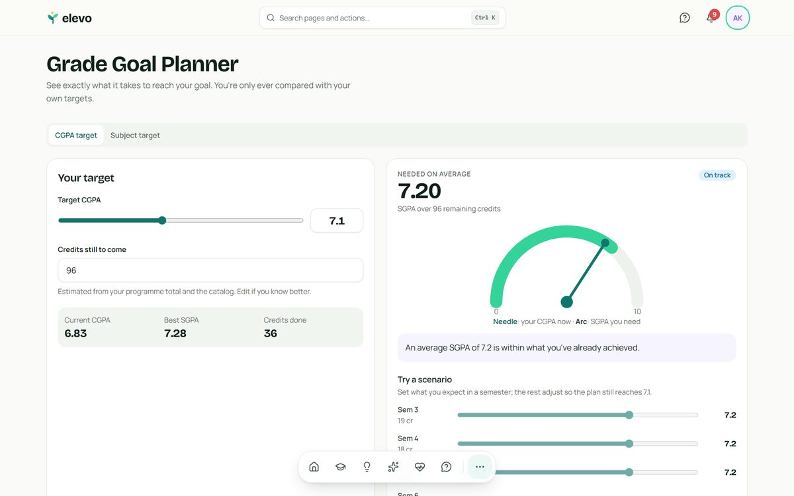 | 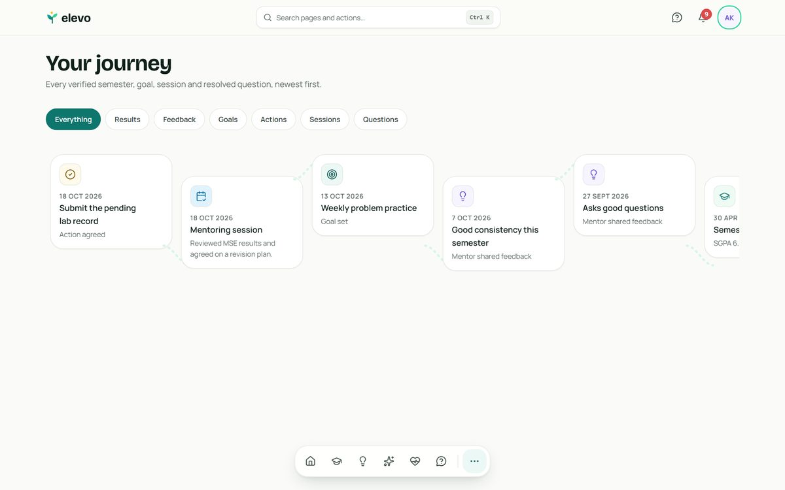 |
| **Mentor home** | **Mentee profile** |
| 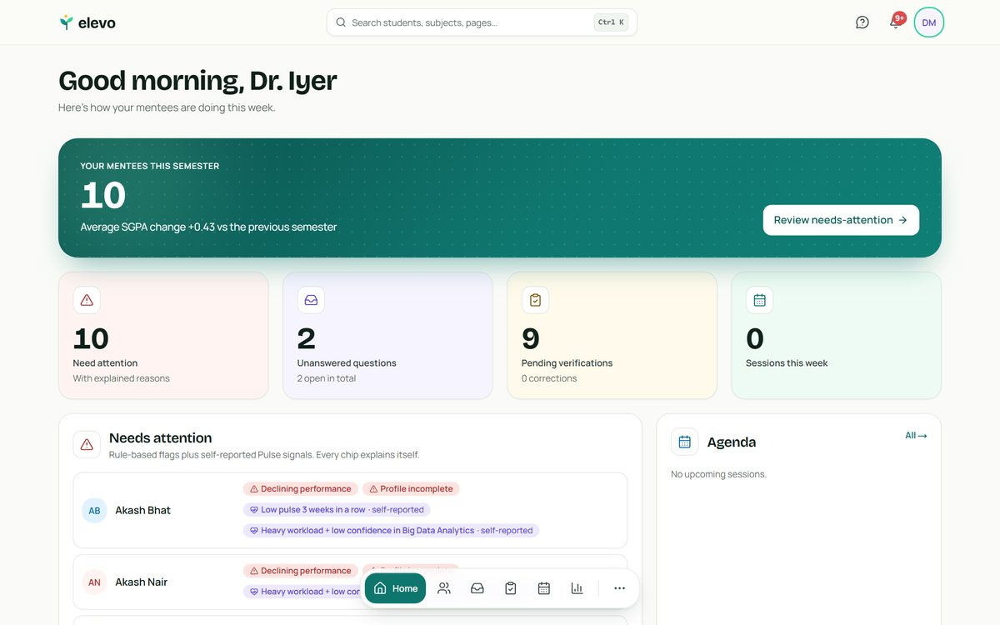 | 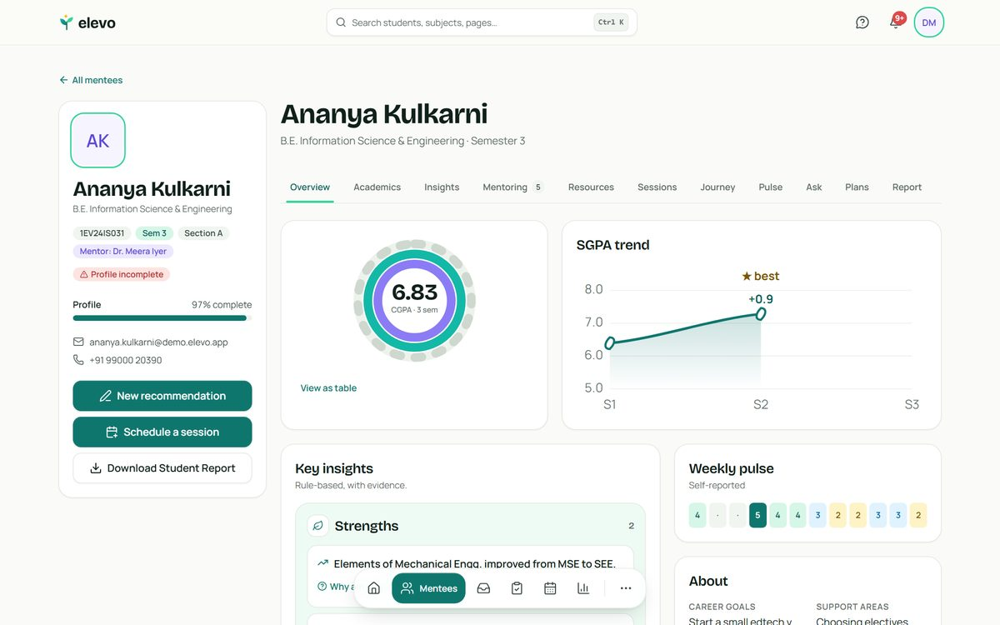 |
| **Verifications** | **Ask inbox** |
| 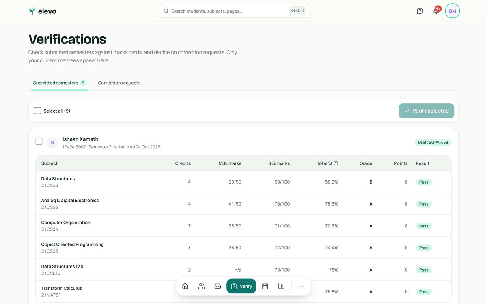 | 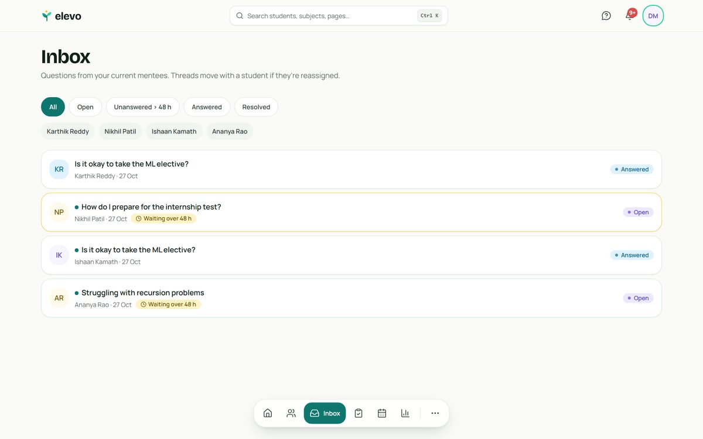 |
| **HOD overview** | **Assignment Board** |
| 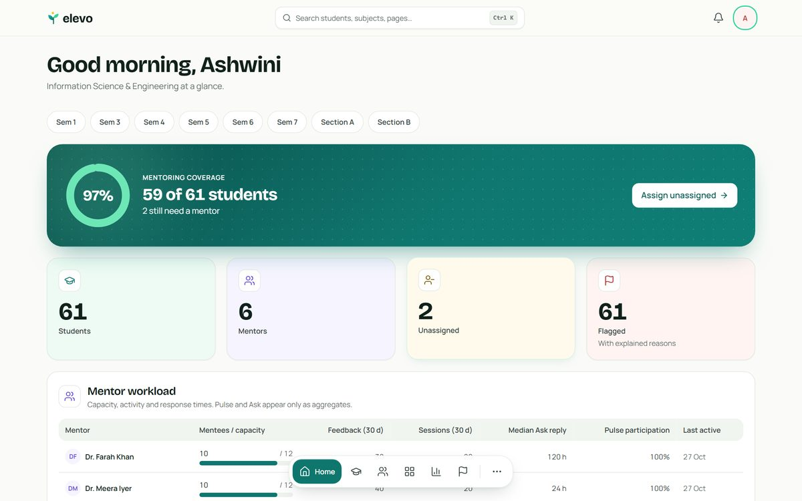 | 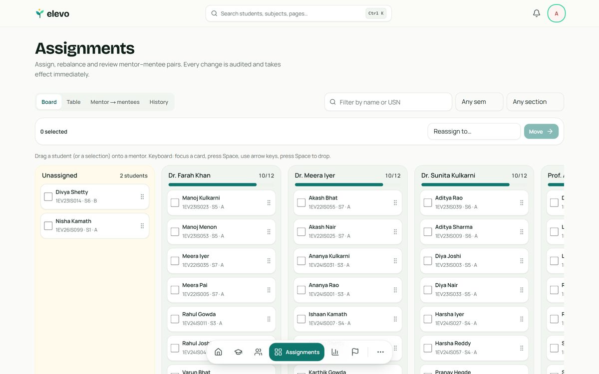 |

<p align="center">
  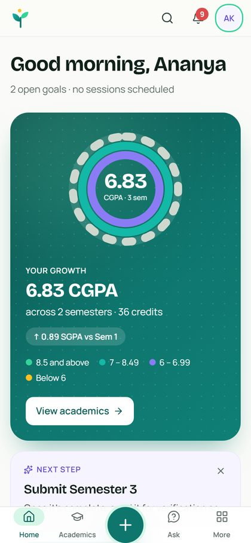
  &nbsp;&nbsp;
  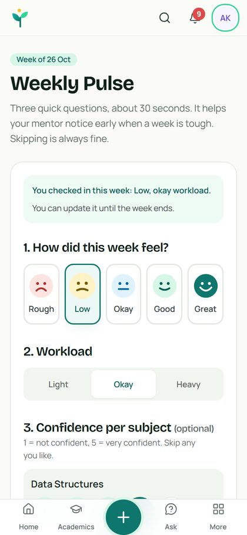
</p>

## 🧭 How it works

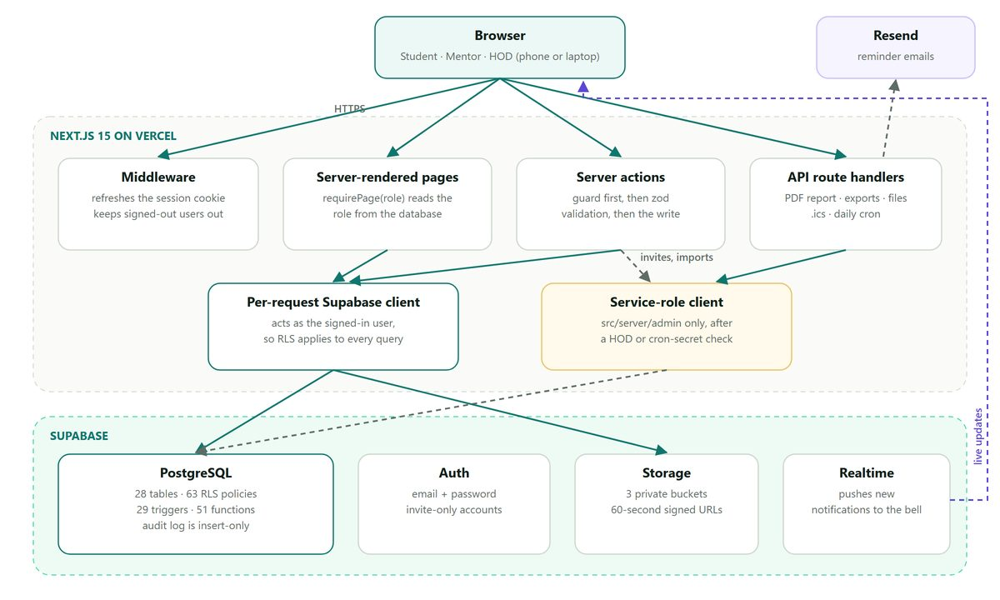

Authorization lives in the database, not only in the UI. Every table has row-level security, `SECURITY DEFINER` helpers decide who is whose mentor, guard triggers protect individual columns, and multi-row workflows run inside transactional Postgres functions. Each server action and route then checks the caller again, and a unit test fails the build if any action skips that check.

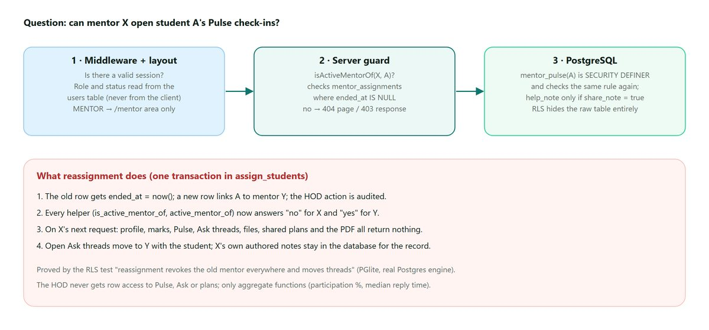

## 🛠 Tech stack

Next.js 15 (App Router, RSC, Server Actions) · TypeScript strict · Tailwind CSS v4 · Radix primitives · Motion · dnd-kit · cmdk · zod · Supabase (Postgres + RLS, Auth, Storage, Realtime) · @react-pdf/renderer · papaparse + exceljs · Resend · Vercel Cron · Vitest · PGlite (in-process Postgres for RLS tests) · Playwright + axe.

Docs: [DESIGN.md](DESIGN.md) · [ARCHITECTURE.md](ARCHITECTURE.md) · [FEATURES.md](FEATURES.md) · [PROGRESS.md](PROGRESS.md) · [DEPLOY.md](DEPLOY.md) · [USER_GUIDE.md](USER_GUIDE.md) · [DEMO.md](DEMO.md)

## Setup

1. **Tools:** Node 20+ and pnpm (`npm i -g pnpm`). The Supabase CLI is a dev dependency (`pnpm supabase …`) — a global npm install isn't supported.
2. **Install:** `pnpm install`
3. **Supabase:** create `elevo-dev` (and later `elevo-prod`). In the dashboard: turn **off** "Allow new users to sign up", keep email confirmation on, set Site URL `http://localhost:3000` and redirect `http://localhost:3000/**`, and configure custom SMTP with Resend.
4. **Secrets:** `cp .env.example .env.local` and fill it in. `pnpm check:env` lists missing names (never values). Never commit `.env.local`.
5. **Database:**
   ```bash
   pnpm supabase login            # once, uses your access token
   pnpm supabase link --project-ref <SUPABASE_PROJECT_REF>
   pnpm db:push                   # applies supabase/migrations
   pnpm db:seed                   # department, grading scheme, thresholds, first HOD
   pnpm db:demo                   # optional realistic demo data → DEMO.md
   ```
6. **Email templates:** paste `supabase/templates/*.html` into Supabase → Authentication → Emails → Templates (subjects in `supabase/templates/SUBJECTS.md`).
7. **Run:** `pnpm dev` → http://localhost:3000. Sign in with `SEED_HOD_EMAIL` and finish the setup wizard.

Without Supabase keys the public pages and `/styleguide` still render; app routes show a "connect your database" notice.

## Scripts

| Script | What it does |
|---|---|
| `pnpm dev` / `build` / `start` | Next.js |
| `pnpm typecheck` · `pnpm lint` | TypeScript and ESLint |
| `pnpm test` | All Vitest suites (engines, PDF, server-action guards, RLS) |
| `pnpm test:unit` · `pnpm test:rls` | Engines/PDF/guards only · Postgres RLS suite on PGlite |
| `pnpm test:e2e` | Playwright at 390 / 834 / 1440 with axe (signed-in journeys in `tests/e2e/journeys.spec.ts` read demo credentials from `.env.local`) |
| `pnpm db:push` · `db:types` · `db:seed` · `db:demo` | Supabase migrations, types, seeds |
| `pnpm check:env` · `build:emails` | Env check · regenerate email templates |

## Security model (short)

Access is enforced in Postgres: RLS on every table, `SECURITY DEFINER` helpers (`app.user_role()`, `app.is_hod()`, `app.is_active_mentor_of()`), column-guard triggers for fields RLS can't protect, and transactional workflow functions. Every server action and route handler re-checks the caller (`src/server/authz.ts`), and a unit test fails the build if any exported server action skips that check. The service-role key is only used under `src/server/admin/*` after a HOD/system check. Details in [ARCHITECTURE.md](ARCHITECTURE.md).
